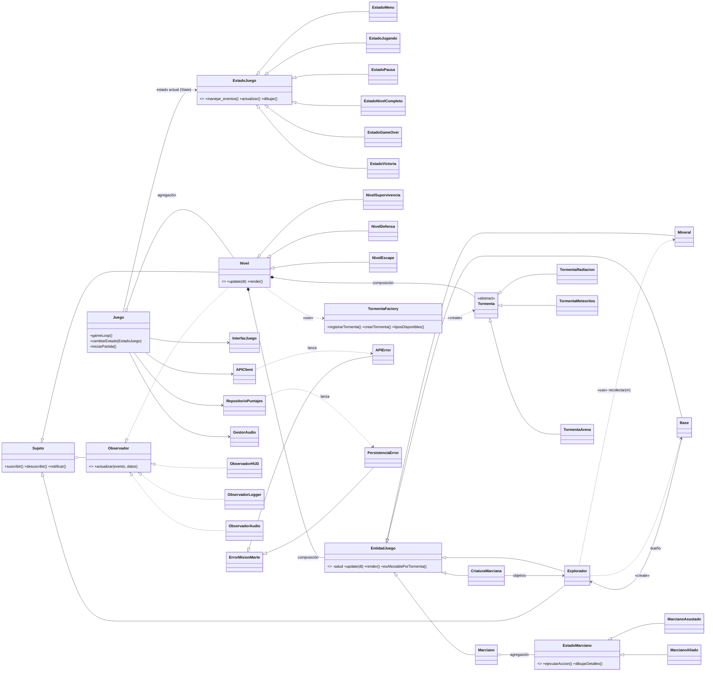

# Diagrama de clases (entrega final)

Mermaid: se visualiza directamente en GitHub o en <https://mermaid.live>.
Notación: `*--` composición · `o--` agregación · `-->` asociación · `..>` dependencia.

